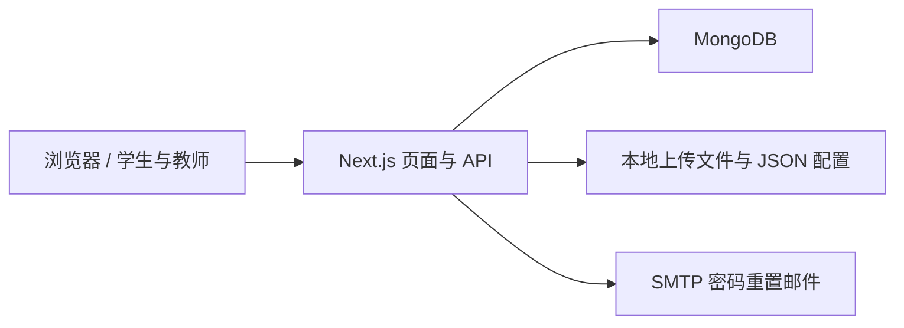

# AI Youth Platform · 青少年 AI 教育展示平台

[English](README_EN.md) · [部署说明](docs/deployment.md) · [贡献指南](CONTRIBUTING.md) · [路线图](ROADMAP.md)

一个面向青少年 AI 教育场景的作品、赛事、荣誉与课程展示平台。帮助教师组织教学成果、学生展示作品，并为机构提供内容管理入口。

> 当前处于开源整理阶段，尚未发布 v1.0.0。已发现的依赖和应用安全问题仍需处理，暂不建议直接用于公开生产环境或存放真实学生敏感资料。见[发布检查清单](docs/releases/v1.0.0-checklist.md)。

## 已有功能

| 模块 | 代码中已有的能力 |
| --- | --- |
| 学生作品 | 图片、视频、HTML 作品上传与详情展示、我的作品 |
| 赛事与荣誉 | 赛事列表、详情、荣誉展示及后台管理 |
| 课程 | 课程列表、课程详情与内容上传 |
| 账户 | 注册、登录、个人资料、修改密码与邮件找回密码 |
| 角色 | student、teacher、admin；具体操作权限由服务端接口判断 |
| 管理后台 | 内容管理、用户角色管理、站点与存储配置入口 |
| 检索 | 跨内容搜索与首页展示 |

这里的 AI 指教学应用场景，当前仓库未实现大模型对话、自动评课或 AI 生成服务。后台出现的页面不代表所有运维能力均已完成；功能验收以真实接口和测试为准。

## 技术结构

- Next.js 14 App Router、React 18、TypeScript、Tailwind CSS。
- MongoDB / Mongoose 保存账户及业务记录；部分上传元数据和配置保存在本地 JSON 文件。
- JWT Bearer 认证、bcrypt 密码散列、Nodemailer 密码重置邮件。
- 上传主要保存至本地磁盘。Cloudinary 域名配置和历史环境变量不等于已实现云上传服务。



## 本地启动

准备 Node.js、npm 与独立测试 MongoDB。当前锁定依赖要求的 Next.js 最低 Node 版本是 18.17；这只是兼容性下限，不是生产版本建议。本轮检查环境为 Node.js 24.11.1 / npm 11.6.2。

```bash
git clone https://github.com/xuxutadie/ai-youth-platform.git
cd ai-youth-platform
npm ci
```

在根目录创建自己的 `.env.local`，配置以下键；将两个占位密钥换成分别生成的随机值，至少 32 字符。

```dotenv
MONGODB_URI=mongodb://127.0.0.1:27017/ai-youth-platform-dev
JWT_SECRET=REPLACE_WITH_A_RANDOM_SECRET_AT_LEAST_32_CHARACTERS
JWT_RESET_SECRET=REPLACE_WITH_ANOTHER_RANDOM_SECRET_AT_LEAST_32_CHARACTERS
USE_MOCK_DB=false
NEXT_PUBLIC_APP_URL=http://localhost:3000
```

生成一个随机密钥：

```bash
node -e "console.log(require('node:crypto').randomBytes(32).toString('hex'))"
npm run dev
```

打开 [localhost:3000](http://localhost:3000)。新注册账户始终是学生；首位管理员需要维护者在隔离数据库中为自己核验过的账户设置角色，旧的注册管理员脚本不能作为正式初始化方式。邮件配置及存储限制见[部署说明](docs/deployment.md)。

仅在隔离的本地演示中，显式设置 `USE_MOCK_DB=true` 并以开发模式启动，才会启用模拟账户。模拟登录不验证真实密码；不得将这个开发服务暴露到公网。

## 验证

```bash
npm run type-check
npm run lint
node --test tests/security/auth.test.cjs
npm run build
npm audit --registry=https://registry.npmjs.org
```

安全回归测试使用隔离的数据库和邮件替身，不接触线上数据。旧调试脚本归档在 `tests/manual/`，它们可能写入或删除数据，不作为自动化通过证据。

## 目录

```text
src/                       页面、接口、组件与数据模型
public/                    站点静态资源（不含归档的调试 HTML）
tests/security/            可自动运行的认证回归测试
tests/manual/              历史人工调试脚本和浏览器测试页
docs/development-history/  历史开发报告，不代表当前验收结论
docs/releases/             首次发布草稿与检查清单
.github/                   Issue 和 Pull Request 模板
```

## 应用与参与

适合用于课程成果展示、比赛作品归档及教学项目二次开发。上述是适用场景，不代表已核实的学校部署、用户规模或商业案例。本仓库未提供经过核验的在线演示地址和真实教学截图，不放置占位演示链接或虚构数据。

- 问题与建议：[GitHub Issues](https://github.com/xuxutadie/ai-youth-platform/issues)。
- 贡献方式：[CONTRIBUTING.md](CONTRIBUTING.md)。
- 安全报告：[SECURITY.md](SECURITY.md)，请勿公开提交令牌或学生资料。
- 维护者：[xuxutadie](https://github.com/xuxutadie)。
- 许可证：[MIT](LICENSE)。第三方库和素材保留各自权利，参见 [第三方素材说明](docs/third-party-assets.md)。
